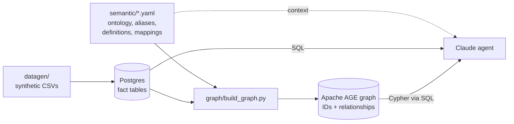

# Semantic layer + knowledge graph for CAR-T validation traceability

**Does a semantic layer make AI agents better at answering GxP traceability questions?** This repo builds a synthetic CAR-T process development and validation database in Postgres, adds a thin knowledge graph with Apache AGE and a YAML semantic layer, and tests Claude agents with and without the layer.


## Results at a glance

| Model | Raw tables | With semantic layer |
|---|---|---|
| Claude Haiku 5.5 | 0.88 | **0.92** |
| Claude Sonnet 5.5 | 0.91 | **0.97** |

Mean score across six multi-hop questions (1.0 = fully correct), 62 scored runs.

- **The gain is concentrated in definitions and vocabulary.** A requirement whose only test was invalidated by a later change control was flagged in 6 of 6 runs with the layer and 2 of 9 without it.
- **Haiku with the layer ≈ Sonnet without it,** at about 1/12 of the API cost per question.
- **It's not magic.** Three questions were solved by every agent, and the longest causal path (0 of 18 runs) was missed with or without the layer.

Full write-up, including the limitations and every correction made along the way: **[docs/agent_results.md](docs/agent_results.md)**.

## How it works



- **Fact tables hold the values.** There's one table per unit operation, plus QC (LIMS-style), historian, validation and QMS records. The names are deliberately terse and inconsistent, the way real PD and LIMS exports are.
- **The graph holds identities and relationships only:** batches, step runs, lots, equipment, requirements, specs, risks, protocols, tests, deviations, CAPAs, change controls, parameters and quality attributes. No measurements, text or statuses are copied into it. Queries traverse the graph for IDs, then join to the tables for content.
- **The YAML is the single source of truth.** It defines the ontology, the aliases people actually use ("TE", "%CAR+", "IOQ", "CR"), the definitions of computed concepts ("currently verified", "high criticality"), and how each node and edge is built. The same files build the graph and go into the agent's context.
- **Everything lives in one Postgres database.** AGE is a Postgres extension, so there's no separate graph database to run or sync.

Details: [docs/validation_model.md](docs/validation_model.md). It covers the node and edge types, how a critical process parameter connects to the tests that verify it, and what belongs in the graph vs. the tables.

## Why validation traceability

Questions like these are 3–5 hops across risk assessments, specifications, tests, executions, change controls and batch data:

- Which high-risk requirements aren't *currently* verified?
- If we raise the transduction MOI from 5 to 8, what has to be revalidated?
- Do any CAPAs from different deviations trace back to the same cause?
- Did any PPQ batch have a CPP excursion that nobody raised a deviation for?

The data has planted gaps for each one (an untested requirement, a test made stale by a change control, a freezer failure that quietly degraded a vector lot, and more). The answer key is in [docs/data_stories.md](docs/data_stories.md). Don't give that file to an agent.

## Quickstart

Requires Docker Desktop and Python 3.10+.

```powershell
copy .env.example .env
docker compose up -d                 # Postgres 18 + Apache AGE 1.8.0
python -m venv .venv
.venv\Scripts\Activate.ps1           # macOS/Linux: source .venv/bin/activate
pip install -r requirements.txt
python -m datagen.generate           # writes ./data/*.csv
python scripts\load_db.py            # creates schema pd and loads the CSVs
python graph\build_graph.py          # builds the AGE graph from the YAML
python scripts\verify.py             # checks the planted stories and graph answers
python scripts\run_demo.py           # runs six graph queries next to naive flat-table SQL
```

Connect with any Postgres client on `localhost:5455` (database `cartpd`, user and password `cart`). Before calling `cypher()` in a SQL session, run `LOAD 'age'; SET search_path = ag_catalog, "$user", public;`.

## Run the agent comparison

```powershell
python agent\selftest.py                     # free plumbing check, no API calls
$env:ANTHROPIC_API_KEY = "sk-ant-..."         # or put it in .env (git-ignored)
python agent\run_eval.py                     # Haiku + Sonnet, raw + semantic, 6 questions
python agent\run_eval.py --models haiku --questions q1 q3 q4 --runs 5
python agent\run_eval.py --rescore agent\results\<run>   # re-score with the current key, no API calls
```

A single full pass costs about $2. Each run saves a report, scores and a full transcript, including every SQL statement the agent wrote.

## Repository layout

```
datagen/          synthetic data generator (process + validation/QMS records)
db/               Postgres schema and init script
semantic/         YAML semantic layer: process.yaml, validation.yaml
graph/            build_graph.py: YAML + tables -> AGE graph 'cart_kg'
demo/queries/     six questions as Cypher + SQL, each with a naive flat-table version
agent/            Claude agent harness, answer key (questions.yaml), results
scripts/          load, verify, run demo, make figures
docs/             results report, model, demo questions, terminology review, data stories
media/            LinkedIn video (MP4), GIF, and the HTML they're rendered from
```

## Documentation

| Doc | What's in it |
|---|---|
| [agent_results.md](docs/agent_results.md) | The agent evaluation: setup, results, cost, corrections, limitations |
| [validation_model.md](docs/validation_model.md) | Node and edge types, CPP → test traceability, graph vs. table split |
| [demo_queries.md](docs/demo_queries.md) | The six questions, the graph answer, and the naive flat-table answer |
| [terminology_review.md](docs/terminology_review.md) | Terminology checked against GAMP 5, FDA CSA and the guidance that applies to CAR-T, plus where the synthetic data is unrealistic |
| [data_stories.md](docs/data_stories.md) | Planted stories and gaps (the answer key) and the sources for the process ranges |

## Limitations

- **The data is synthetic.** Process ranges are informed by published CAR-T work, but the validation package is far smaller and tidier than a real one.
- **The sample is small.** 3–6 runs per cell on the hard questions; a direction, not a statistical result.
- **Only Claude models were tested,** on one dataset.
- **This is not validation advice.** If a graph like this supports GxP decisions, the graph build and semantic layer themselves need a risk-based validation approach (see [validation_model.md](docs/validation_model.md) §4).

## Built with

PostgreSQL · [Apache AGE](https://age.apache.org/) · Python · Claude (Haiku 5.5, Sonnet 5.5) via the Claude API.

## License

Apache-2.0. See [LICENSE](LICENSE).
