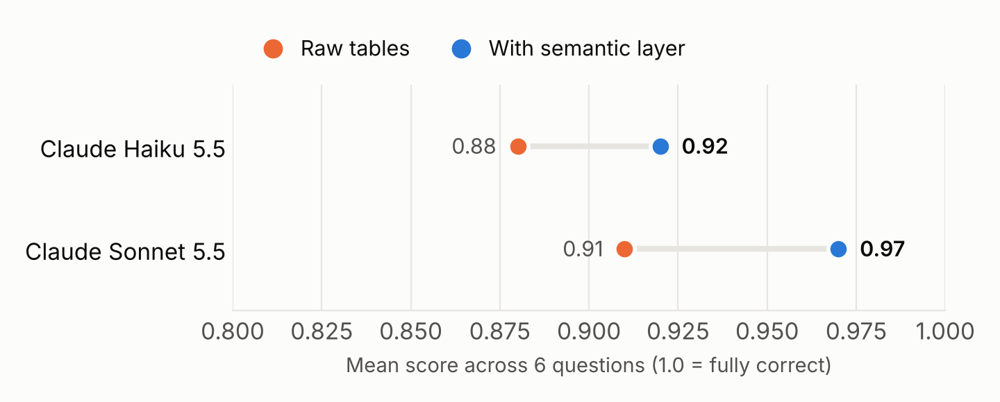
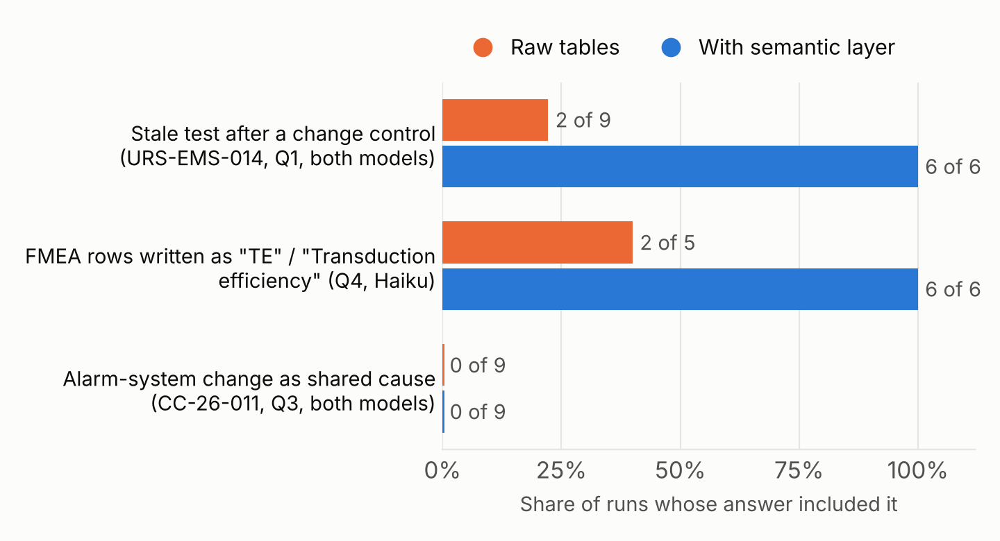
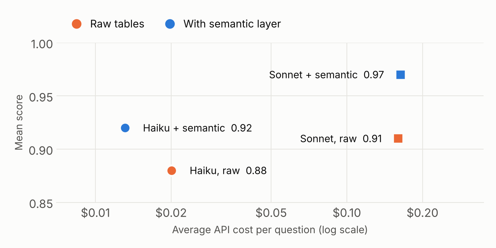

# Results: AI agents with and without a semantic layer

**Question:** when an AI agent answers process and validation traceability questions over a CAR-T database, does a semantic layer (a YAML ontology plus a thin knowledge graph in Apache AGE) make its answers more correct?

**Short answer:** yes, modestly, and in a specific place. The layer made the biggest difference on questions whose answer depends on the team's *definitions* (what counts as "currently verified") and *vocabulary* (that "TE" and "%CAR+" are the same thing). On questions the data answers by itself, agents without the layer did just as well. With the layer, Claude Haiku matched Claude Sonnet without it, at about a twelfth of the cost.



## Setup

| | |
|---|---|
| Data | Synthetic CAR-T process development, engineering and PPQ batches, plus validation (URS, specs, risk assessments, protocols, tests) and QMS records (deviations, CAPAs, change controls). Postgres 18 + Apache AGE 1.8. |
| Models | Claude Haiku 5.5 and Claude Sonnet 5.5, via the Claude API |
| Tool | One read-only SQL tool, identical in both conditions |
| Condition **raw** | The agent sees only the table and column names. The graph is blocked and invisible to its database user. |
| Condition **semantic** | The agent also gets `semantic/process.yaml` and `semantic/validation.yaml` (ontology, aliases, definitions, table mappings) and can query the graph with `cypher()` through the same SQL tool. |
| Questions | 6 questions needing 3–5 hops across risk, specification, test, execution, change, deviation and batch records (`agent/questions.yaml`) |
| Scoring | The agent ends with a JSON list of record IDs, which is scored against the answer key: F1, recall for the two open-ended questions, and "cause clusters" for Q3. |
| Runs | 66 runs in total, 62 scored (see "Corrections" for the 4 excluded). Q1, Q3 and Q4: 3–6 runs per cell. Q2, Q5 and Q6: 1 run per cell, because every agent solved them on the first pass. |

## Results

**Mean score** (average of per-question means, 1.0 = fully correct):

| Model | Raw tables | Semantic layer | Change |
|---|---|---|---|
| Claude Haiku 5.5 | 0.88 | 0.92 | +0.04 |
| Claude Sonnet 5.5 | 0.91 | 0.97 | +0.06 |

**By question:**

| Question | Haiku raw | Haiku semantic | Sonnet raw | Sonnet semantic |
|---|---|---|---|---|
| Q1 Unverified high-risk requirements | 0.83 | **1.00** | 0.87 | **1.00** |
| Q2 Impact of raising MOI (CC-26-022) | 1.00 | 1.00 | 1.00 | 1.00 |
| Q3 CAPAs with a shared upstream cause | 0.60 | 0.55 | 0.60 | 0.80 |
| Q4 Traceability chain for %CAR+ | 0.85 | **1.00** | 1.00 | 1.00 |
| Q5 High-risk FMEA items with OQ but no PQ | 1.00 | 1.00 | 1.00 | 1.00 |
| Q6 CPP excursions during PPQ | 1.00 | 1.00 | 1.00 | 1.00 |



### Where the semantic layer made the difference

**Definitions: a test made stale by a change control.** URS-EMS-014 (after-hours alarm escalation) was tested in January. In March, change control CC-26-011 rebuilt the configuration it depends on and recorded "no re-testing required". The semantic layer defines a requirement as verified only if its latest passing test is dated after any change to it.
- With the layer: flagged in **6 of 6** runs.
- Without it: flagged in **2 of 9** runs.

The raw agents usually *saw* the issue. Their answers mention the change. But they accepted the change control's own judgment and counted the requirement as verified. The semantic layer gave them the team's rule, and they applied it.

**Vocabulary: one CQA, three names.** The FMEA refers to %CAR+ as "%CAR+", "TE" and "Transduction efficiency" in different rows. Haiku found both of the rows using the other names in **6 of 6** runs with the layer and **2 of 5** without it. Sonnet found them either way.

### Where it made no difference

- **Q2, Q5 and Q6:** every agent in both conditions got them fully right. Raw agents explored with about 20 SQL calls per question and found things like the historian temperature excursion and the missing PQ on their own.
- **Q3:** the data contains three groups of CAPAs with a shared cause. Agents in both conditions found the freezer → vector lot → engineering-run group and the incubator-door group. **No agent found the third** (0 of 18 runs): two deviations that both trace back to a change in the alarm-notification configuration (CC-26-011). That path is the longest in the dataset, and the semantic layer didn't close it.

### Cost



| | Average cost per question | Mean score |
|---|---|---|
| Haiku, raw | $0.020 | 0.88 |
| **Haiku + semantic layer** | **$0.013** | **0.92** |
| Sonnet, raw | $0.160 | 0.91 |
| Sonnet + semantic layer | $0.164 | 0.97 |

Haiku with the semantic layer scored about the same as Sonnet without it, at roughly 1/12 of the cost. The semantic prompt is larger (about 10,000 tokens), but prompt caching makes it cheap after the first call, and the semantic agents needed fewer SQL calls. Haiku raw costs include the four excluded runs, which consumed tokens before being cut off.

## What we learned beyond the numbers

1. **Hand-written "naive" queries badly underestimate real agents.** Before running agents, we wrote plausible flat-table SQL for each question (`demo/queries/*.naive.sql`). Those queries failed on most questions. Real agents without the semantic layer explored, checked their assumptions and solved half the questions outright. Any claim that "agents need a knowledge graph" should be tested with real agents, not strawmen.
2. **The semantic layer's value is in definitions more than in the graph.** The clearest gain came from a one-paragraph rule in the YAML, not from multi-hop traversal. Agents without the graph traversed the link tables with SQL just fine.
3. **Agents found answers our key had missed.** On Q3, agents identified two real shared-cause groups that were not in the first answer key. On Q1, raw Sonnet argued that a freezer requirement specifying a "representative load" isn't verified by an empty-chamber test, which a QA reviewer could fairly say too. Reading the transcripts mattered as much as the scores.

## Corrections made during the evaluation

We made these changes in the open. Each one applies equally to both conditions.

- **Harness bug (4 runs excluded):** Haiku uses extended thinking by default. On four runs it used the whole 8,000-token output limit before writing an answer, so those runs had no answer text and are excluded. The harness now allows 32,000 output tokens, retries when a reply is cut off before any answer, and asks once more if the answer list is missing.
- **Q3 answer key:** widened from one shared-cause group to the three that exist in the data.
- **Q1 answer key:** URS-CRF-001 and URS-PRDG-002 are no longer penalized as extras, because each has a requirement clause its only test doesn't cover.
- **Q4 answer key:** URS-EBR-009 is no longer required. It controls MOI being too high, which affects VCN rather than %CAR+.
- **Data:** the freezer deviation and equipment log now record where the vector lot went during the freezer repair. Several agents had correctly flagged the records as inconsistent.
- **Hint removal:** the YAML's historian examples originally used the same equipment as the planted stories (INC-03, FRZ-80-02). We changed them to INC-01 and FRZ-80-01 before the agent runs.

## Limitations

- **Small sample.** 3–6 runs per cell on the hard questions and one on the others. That's enough to show a direction, not to support statistical claims.
- **Questions that hint.** The questions use terms like "PPQ acceptance range" and "OQ/PQ", which hand the raw agent part of the answer. Vaguer, more realistic phrasing would probably widen the gap.
- **Synthetic data.** One dataset, with planted stories. Real validation packages are larger and messier (see `docs/terminology_review.md`).
- **One model family.** Only Claude models were tested.
- **The answer key was adjusted after seeing results.** Every change is listed above and in `agent/questions.yaml`.

## Reproduce

```powershell
python agent\selftest.py                                    # free plumbing check
python agent\run_eval.py                                    # full pass, both models
python agent\run_eval.py --models haiku --questions q1 q3 q4 --runs 5
python agent\run_eval.py --rescore agent\results\<run1> agent\results\<run2>   # merge + re-score, no API calls
python scripts\make_figures.py                              # redraw the charts from summary.json
```

Merged report: `agent/results/combined/report_rescored.md`. Numbers used here: `agent/results/combined/summary.json`.
