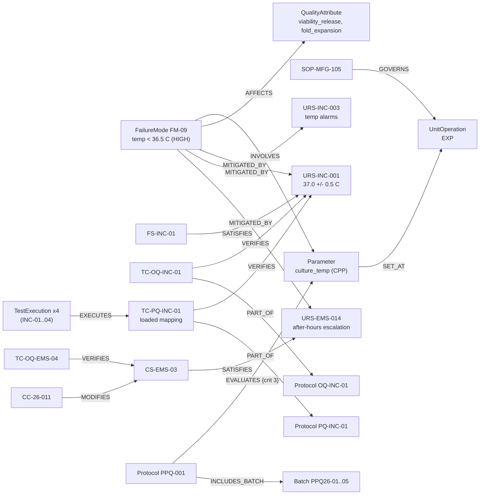

# Validation and traceability model

This extends the CAR-T process graph with validation, qualification and QMS records. The validation entities hang off the same `Batch`, `StepRun`, `Equipment`, `MaterialLot`, `Parameter` and `QualityAttribute` nodes the process graph already has. They are not a separate island.

The principles are the same as before:

- **Thin graph.** AGE holds identities and relationships only.
- **Tables hold content.** Values, text, scores, results and dates stay in the `pd` tables.
- **YAML is the single source of truth.** `semantic/*.yaml` defines the node types, the edge types, and the SQL each one comes from. The same files go to the agent as context.

## 1. Node types

The process nodes already existed. The validation nodes are new; five of them (marked ➕) were added to the starting list after the terminology review.

| Label | What it is | Built from | Properties on the node |
|---|---|---|---|
| `Batch`, `StepRun`, `UnitOperation`, `Equipment`, `MaterialLot`, `Donor`, `Leukopak` | Process graph | process tables | `id` (+ `run_type` on Batch) |
| `Parameter`, `QualityAttribute` | Ontology | `semantic/process.yaml` | `id`, `name`, `criticality` |
| ➕ `System` | Validated system boundary (equipment family or computerized system) | `val_system` | `id`, `sys_class` |
| `UserRequirement` | URS line item | `val_spec_item` (URS) | `id`, `req_category` |
| `FunctionalSpec` | FS line item (often supplier) | `val_spec_item` (FS) | `id` |
| ➕ `ConfigurationSpec` | CS line item (GAMP Cat. 4) | `val_spec_item` (CS) | `id` |
| `DesignSpec` | DS line item (Cat. 5 custom code only) | `val_spec_item` (DS) | `id` |
| `RiskAssessment` | The pFMEA or FRA document | `val_risk_assessment` | `id`, `ra_type` |
| ➕ `FailureMode` | One FMEA / FRA row. This is the unit that gets linked to controls. | `val_risk_item` | `id` |
| `Protocol` | IQ / OQ / PQ (equipment), PPQ (process), AMV (method) | `val_protocol` | `id`, `ptype` |
| `TestCase` | Test or verification activity | `val_test_case` | `id` |
| `TestExecution` | One execution of a test case on one unit or system | `val_test_exec` | `id` |
| ➕ `AnalyticalMethod` | QC method, validated per ICH Q2(R2) | `analytical_method` | `id` |
| `SOP` | Procedure | `sop` | `id` |
| `Deviation` | Deviation, protocol deviation, test incident, atypical result | `qms_deviation` | `id`, `record_type` |
| `CAPA` | Corrective or preventive action | `qms_capa` | `id` |
| `ChangeControl` | Change record | `qms_change_control` | `id` |
| ➕ `RootCauseCategory` | The picklist value the investigator chose | `qms_deviation.rc_category` | `id` |

Why the five additions matter: see `docs/terminology_review.md`. In short, a validation reviewer would expect:

- the FMEA row (not the document) to be the thing linked to controls
- a system boundary that requirements and protocols are written against
- a configuration spec for configured products
- the analytical method between a CQA and its release result
- root cause *categories* kept separate from root cause narratives

## 2. Edge types

| Edge | From → To | Meaning | Source |
|---|---|---|---|
| `APPLIES_TO` | UserRequirement → System | Requirement is written against this system | `val_spec_item.sys_id` |
| `PART_OF` | Equipment → System; TestCase → Protocol | Membership | FK columns |
| `MONITORS` | System(EMS) → Equipment | EMS channel configuration | `trace_link` |
| `SATISFIES` | FunctionalSpec / ConfigurationSpec → UserRequirement | Spec item satisfies the requirement | `trace_link` TRACE |
| `IMPLEMENTS` | DesignSpec → FunctionalSpec | Design implements the function | `trace_link` TRACE |
| `VERIFIES` | TestCase → URS / FS / CS / DS | Test challenges this item | `trace_link` VERIFIES |
| `EXECUTES` | TestExecution → TestCase | Execution record of a test | `val_test_exec.tc_id` |
| `PERFORMED_ON` | TestExecution → Equipment / System | Unit the test was executed on | `val_test_exec.target_id` |
| `COVERS` | Protocol / RiskAssessment → System | Scope | FK columns |
| `VALIDATES` | Protocol(AMV) → AnalyticalMethod | Method validation | `val_protocol.method_id` |
| `INCLUDES_BATCH` | Protocol(PPQ) → Batch | PPQ batch under protocol | `trace_link` |
| `EVALUATES {crit_no}` | Protocol(PPQ) → Parameter / QualityAttribute | Acceptance criterion; `crit_no` keys into `val_ppq_criterion` for the limits | free text resolved by YAML aliases |
| `IDENTIFIES` | RiskAssessment → FailureMode | Row belongs to assessment | `val_risk_item.ra_id` |
| `AT_STEP` | FailureMode → UnitOperation | FMEA "process step" column | free text resolved by aliases |
| `INVOLVES` | FailureMode → Parameter | FMEA "parameter" column | free text resolved by aliases |
| `AFFECTS` | FailureMode → QualityAttribute | FMEA "CQA impacted" column | free text resolved by aliases |
| `AFFECTS` | Deviation → Batch / Equipment / MaterialLot | Impacted item | `trace_link` RELATED |
| `MITIGATED_BY` | FailureMode → UserRequirement / SOP | Risk control | `trace_link` MITIGATES |
| `ASSESSES` | FailureMode(FRA) → UserRequirement | Functional risk rating of a requirement | `trace_link` ASSESSES |
| `GOVERNS` | SOP → UnitOperation / System | Procedure scope | `sop` columns |
| `AGAINST` | Deviation → Protocol | Protocol deviation | `trace_link` RELATED |
| `RAISED` | TestExecution → Deviation | Test incident from a failed step | `trace_link` RELATED |
| `RESULTED_IN` | Deviation → CAPA | | `trace_link` RELATED |
| `CATEGORIZED_AS` | Deviation → RootCauseCategory | Recorded root cause category | `qms_deviation.rc_category` |
| `IMPLEMENTED_BY` | CAPA → ChangeControl | | `trace_link` RELATED |
| `MODIFIES` | ChangeControl → System / Equipment / SOP / RiskAssessment / spec item | Items in the CC impact assessment | `trace_link` IMPACTS |
| `VERIFIED_BY` | ChangeControl → TestExecution | Post-change re-verification | `trace_link` RELATED |

Process edges already in place: `PROVIDED`, `STARTING_MATERIAL_FOR`, `HAS_STEP`, `INSTANCE_OF`, `NEXT`, `USED`, `RAN_ON`, `STORED_IN`, `SET_AT`, `INFLUENCES`, `MEASURED_BY`.

Note on `trace_link`: the QMS and validation tools export relationships as generic "related records". `link_type` is coarse (`RELATED` means different things for different record pairs). The YAML gives each `(src_type, tgt_type)` pair its real meaning. This is the single biggest thing the flat-table agent lacks.

## 3. How a CPP connects to the tests that verify it

**There is no direct CPP → TestCase edge, on purpose.** In a real validation package, nothing "tests a CPP". The route is:

1. The risk assessment identifies how the parameter can go wrong.
2. Controls are put in place: equipment or system requirements, procedures, IPCs.
3. Those controls are verified by qualification and validation.
4. PPQ demonstrates the CPP is held within its acceptance range on commercial-scale batches. The wider proven acceptable range comes from Stage 1 work (here, the MOI DoE).

The graph follows that route. Here it is for `culture_temp` (incubator temperature during expansion), with real IDs from the data:

Read it as three chains that meet at the parameter:

- **Risk → control → verification** (FM-09 → URS-INC-001 → TC-PQ-INC-01 → executions on each incubator)
- **Process validation** (PPQ-001 evaluates culture_temp with limits 36.5–37.5 °C, across five batches)
- **Change** (CC-26-011 modified the EMS escalation config that one of the controls depends on, after its only test)

Each of the demo questions walks some part of this picture.

## 4. What goes in the graph and what stays in tables

**Rule:** a value goes on a node or edge only if it is part of the *identity or classification* of the thing, meaning what kind of thing it is. It is never a measurement, a score, a status, a date, a limit, or text.

| In the graph (identity / relationship) | In the tables (content) |
|---|---|
| IDs of every record | Requirement text, test acceptance criteria, actual results |
| Links between records (trace, verification, mitigation, impact, affected items) | Test results (PASS / FAIL), execution dates, executed / reviewed by |
| Classification codes needed to filter traversals: `ptype`, `record_type`, `sys_class`, `req_category`, `criticality`, `run_type`, `ra_type` | FMEA scores (S, O, D, RPN) and `risk_class` |
| Keys into content rows on edges (`EVALUATES.crit_no`) | PPQ acceptance limits, tested ranges, validated method ranges |
| | Deviation descriptions, impact assessments, root cause narratives, CAPA actions |
| | Statuses (open / closed), due dates, effectiveness checks |
| | All process measurements, QC results, historian data |

**Judgment calls**, and why each went to the tables:

- **`risk_class`** is used to filter (high criticality), but it's a judgment that changes when the assessment is revised. It needs the audit trail of the system of record, so the query joins to it.
- **Dates** drive staleness and exposure logic. They stay in tables and SQL does the temporal comparison. Putting dates on nodes would duplicate the record and go stale on the next edit.
- **`req_category`** is on the node because it's a classification of what the requirement *is* (performance vs. alarm). It decides whether PQ evidence is expected, which is structural.

**Why bother:**

1. One source of truth. Nothing to sync, because the graph rebuilds from the tables and YAML in a couple of seconds.
2. The audit trail stays in the validated systems of record (QMS, LIMS, validation tool), not in a derived index.
3. When a result is corrected in LIMS, no graph property silently disagrees with it.

**A point validation people will raise:** if this graph is used to make GxP decisions (scoping revalidation, closing a CAPA, approving a PPQ report), then the graph builder and the YAML are themselves a computerized system with GxP impact. Either keep them as decision support with documented human review, or validate them proportionately: requirements, a risk assessment, and the `scripts/verify.py` regression checks as a starting point for test evidence.

## 5. The semantic layer additions

`semantic/validation.yaml` uses the same format as `process.yaml` and adds:

- **`vocabulary`**: each record type with the aliases QA, validation and manufacturing people actually use ("URS", "test script", "IOQ", "NC", "CR", "protocol deviation"...), the table it lives in, and notes. It also spells out the "PQ" ambiguity: equipment PQ vs. process PPQ.
- **`link_table`**: how to read `trace_link`, and why `RELATED` alone means nothing.
- **`definitions`**: how computed concepts are decided. These include `currently_verified_requirement`, `stale_verification`, `high_criticality_failure_mode` (approved risk class, not an RPN cut-off), `pq_expected`, `control_strategy_link`, `cpp_excursion` and `gmp_record_scope`. These are what stop the agent from inventing its own rule.
- **`not_parameters`**: FMEA "parameter" strings that are deliberately not ontology parameters (for example "Tubing set integrity"). This lets the graph build flag anything else that fails to resolve.
- **`entities` / `relationships`**: the graph mapping. Edges built from free text (FMEA columns, PPQ criteria, SOP scope) are resolved through aliases in `process.yaml`. Anything unresolved is reported at build time, so the build doubles as a coverage check on the vocabulary.
